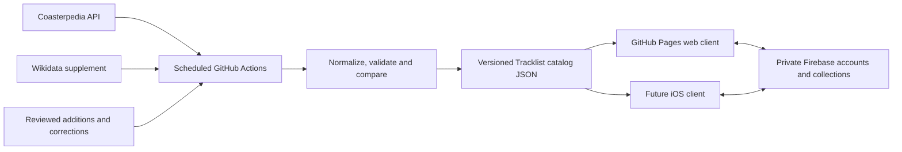

# Tracklist catalog research and proposed update pipeline

Research date: 31 October 2026. This is an audit and implementation proposal, not an enabled ingestion service. No application behavior, hosted infrastructure, Firebase rules or iOS code changed during this investigation.

## Recommendation

Keep GitHub Pages for the web app and Firebase for accounts and personal collections. Build the shared public ride catalog in GitHub Actions, using Coasterpedia's official API as the primary source, Wikidata as a supplement, and reviewed, independently sourced additions for gaps. Publish versioned JSON for Tracklist's web client and a future native client. A database server is not required to search a catalog of this size.

This addresses two different problems: freshness needs an update pipeline; completeness needs additional records, better identities and a correction process. Switching hosts alone solves neither.

## What is wrong with the current catalog

These are measurements of the local bundled catalog, not estimates of worldwide ride totals. The machine-readable audit is in [catalog-audit-2026-10-31.json](catalog-audit-2026-10-31.json).

| Finding | Current bundle |
| --- | ---: |
| Catalog timestamp | 10 October 2026 |
| Ride records | 4,232 |
| Coasterpedia / Wikidata records | 4,191 / 41 |
| Raw park names / normalized park groups | 1,724 / 1,710 |
| Bundle size | 1,442,679 bytes |
| Unknown operating status | 324 |
| Missing manufacturer | 484 |
| Missing RCDB link | 535 |
| Missing direct POV | 1,859 |
| Records with stable park IDs | 0 |
| Records with explicit track definitions / opening dates | 0 / 0 |
| Repeated RCDB identifiers needing review | 14 groups |

The park-group count is not a verified count of distinct parks. It currently depends on normalized names. Four records also contain `ship` in the country field, illustrating why a populated field is not necessarily a correct field. The app's hardcoded track families supply some track choices separately; the zero above describes catalog records only.

Code findings:

1. There is no scheduled catalog workflow. The Pages workflow deploys committed files; it does not collect new records.
2. `scripts/update-coasterpedia.cjs` reuses numbered cached responses whenever they exist, without expiration or source-revision checks. Rerunning it can stamp old data with a new build time. That timestamp is not proof of freshness.
3. Its status mapping does not recognize all full status labels, including `Under construction`, so some source states become `Unknown`.
4. Its RCDB extraction takes the first RCDB template in the article, which can refer to something other than the intended ride. Repeated identifiers are review candidates, not proof of duplicate rides. Examples include Salama/Tarántula and multiple historical names or locations. `core.js` currently accepts matching RCDB links as an identity match, making incorrect links consequential.
5. `scripts/update-catalog.cjs` requires an RCDB identifier and a matching amusement-park relationship before retaining a Wikidata ride. That unnecessarily excludes some otherwise useful candidates, including newly documented rides.
6. The combined exporter clears park IDs. Current park grouping cannot reliably distinguish same-name parks or retain identity through renames.
7. Opening dates, status history and source track definitions are not exported. The app therefore cannot infer an opening transition from the catalog's current schema.

Do not run a fresh bulk crawl with the legacy wiki updater as the solution. The current API terms direct automated reading to the official API, rather than bulk wiki pages or `api.php`.

## Sources and permission boundaries

| Source | Proposed role | Reuse/access assessment |
| --- | --- | --- |
| [Coasterpedia API](https://developer.coasterpedia.net/) | Primary ride, park and manufacturer source | Structured records and a documented incremental feed; use its supported API. |
| [Wikidata](https://www.wikidata.org/wiki/Help:Data_access) | Supplement identities, aliases and missing facts | Structured data is CC0. Use polite, bounded queries and retain provenance. |
| [RCDB](https://rcdb.com/tou.htm) | External links; possible future permission-based partnership | Its terms require prior written permission to use content to construct other databases, websites or apps. No scraper or unofficial scraped API in the proposed pipeline. |
| [Captain Coaster](https://captaincoaster.com/en/terms-conditions) | Not a bulk source without a separate agreement | Its terms prohibit mass extraction. A reachable endpoint is not a redistribution licence. |
| [OpenStreetMap](https://www.openstreetmap.org/copyright) | Optional separate geography/discovery dataset | ODbL, with its own attribution and share-alike obligations. Do not silently fold it into a differently licensed catalog. |
| Park/manufacturer announcements and contributions | Reviewed coverage gaps and opening evidence | Approve sources and reuse terms individually. Link factual evidence; do not copy descriptions, images or an unlicensed inventory in bulk. |

Coaster-Count itself describes collaborating with RCDB for stationary rides. That helps explain why an independent open-data catalog should not promise matching coverage immediately. [Coaster-Count about page](https://cdn.coaster-count.com/page/about)

### Coasterpedia API findings

I verified the unauthenticated `/v1/meta?view=latest` and `/v1/vocabularies` endpoints with HTTP 200. The metadata response reported `1.0.0-beta.24`, 21,375 attractions and 2,194 parks, with `data_as_of` 2026-10-31T14:52:13Z. Attractions include other rides and water slides: this is **not** 21,375 roller coasters. The wiki statistics page separately reports approximately 4,300 coaster articles. Counts and scopes differ, so they cannot establish Tracklist's eventual coverage. [API metadata](https://api.coasterpedia.net/v1/meta?view=latest), [wiki statistics](https://coasterpedia.net/wiki/Coasterpedia:Statistics)

Full attraction records require an API key. No authenticated catalog import was performed; per-park completeness and actual replacement-record counts remain unverified.

The [API terms](https://developer.coasterpedia.net/terms/), version 1 dated 28 October 2026, distinguish the CC BY-SA 4.0 data licence from access to their servers. A free, ad-free fan app qualifies for a free key; payments, paid features, adverts or business use require a commercial arrangement. This matters before monetizing a future iOS app. Keep the key in CI, never in the website or a downloadable app. Attribute the data and distribute derived catalog data under the applicable licence. Code and personal user content are separate. Respect deletions and avoid operating a replacement public mirror/API that could jeopardize service access. Confirm any standalone bulk-data distribution with the provider.

The API is still beta. Schema validation and fallback to the previous good release are essential, not optional polish.

## Proposed automatic pipeline

The native boxes describe a future interface contract only.

### Bootstrap and updates

Bootstrap a local application cache once, including planned, operating, closed and historical coasters. Enumerate `type=coaster`, collect IDs, then fetch full records in batches. Parks need their own records. Keep travelling/showman locations as typed locations rather than discarding rides without conventional parks. The docs support list pages of 100 and full-record ID batches of 50. [Getting started](https://developer.coasterpedia.net/docs/)

Poll the change feed every six hours, scheduled away from the top of the hour. Start the bootstrap cursor at the time collection began, then replay intervening changes so records edited during the initial download are not missed. Apply updates idempotently; process deletes and merged IDs; advance the saved cursor only after a complete, validated candidate is durable. A deployment failure must retry publication even if the next poll finds no further source changes. A cursor older than the feed's 90-day window requires rebuilding the source cache. [Change-feed guide](https://developer.coasterpedia.net/docs/changes/)

Use conservative request pacing, retries with jitter and `Retry-After`. The documented free limit is 60 requests/minute across an account, not per key. Search visits must never generate one upstream call per visitor. [Limits](https://developer.coasterpedia.net/docs/errors/)

For normal ingestion, use the same view for the snapshot and feed. `settled` can delay recent edits for seven days; `latest` is much faster but can expose unreviewed changes. For Tracklist's opening-day goal, I recommend `latest` plus validation and review of suspicious changes, while retaining settlement information. Do not describe settled data as manually approved. [View definitions](https://developer.coasterpedia.net/docs/views/)

Refresh the Wikidata supplement weekly through a separate adapter. Remove the universal RCDB-ID requirement. Retain incomplete candidates for review instead of forcing uncertain matches into the published catalog. A discovery query should be checked against a small set of recent, historical and geographically varied rides before being trusted for coverage.

### New ride opening example

1. A documented project is imported as Planned or Under construction and is available in upcoming searches and wish lists.
2. A source edit confirms it is operating. The next successful poll updates that same ride identity, validates the change and publishes a new catalog release.
3. The web client checks the manifest and fetches the changed catalog, making the ride visible in the ordinary current-rides view. A future native client uses the same release.

The suggested six-hour schedule is a processing target after an upstream update, not a guarantee measured from the real-world opening. If nobody updates an allowed source, automation cannot know. A proposed opening date passing midnight must never by itself change a ride to Operating. Preserve year-only or uncertain dates rather than inventing a precise day. Historical logging must remain available.

### Data model and identity

Maintain application-owned identities with source mappings. Preserve existing `cp-<pageid>` references where valid; add migration mappings rather than changing users' private ride UUIDs. Model parks and manufacturers as entities with stable IDs and aliases, not just display names.

Separate a coaster, its installation/location history and its tracks. A rename should not create a new credit; a relocation or substantial rebuild may need an explicit installation/credit policy. Do not merge those cases solely by RCDB ID or similar names. Never silently collapse a user's existing credits during a catalog refresh.

Normalize into fields such as:

- Stable ride/park IDs, names, aliases and source-identity mappings.
- Status and status evidence; opening/closing dates with precision; current and previous locations.
- Manufacturer references, broad ride type and more specific categories.
- Track identities, names when known, and track counts; never assume all tracks were ridden.
- Coordinates, link references and optional video identifiers.
- Per-source revision, source URL, licence, retrieval time and uncertainty/conflict flags.

The API documents histories, dates, categories, video IDs and track details. A count of identical tracks and separately described tracks are different cases. Unknown names should remain unknown or be clearly labeled generically. Its published contract does not document an RCDB field; preserve validated existing links and supplement them from permitted sources instead of promising the API supplies them. [API reference](https://developer.coasterpedia.net/docs/reference/)

Keep user notes, ridden dates, ranking order, ride/track counts and favorites independently saved. Source deletions remove catalog-search entries, with minimal identity redirects/tombstones where needed; they must not erase personal ride history. Public-field removal and personal-data retention are separate operations.

### Validation and publication

Treat upstream JSON as untrusted input. Validate sizes, identifiers, date precision, coordinate bounds and URL allowlists. Do not execute downloaded JavaScript. Flag unexpected schema values, conflicting identities, sudden record-count reductions and large status changes. For example, a two-percent unexplained catalog drop can hold a candidate for review; that threshold is a proposed control, not a source guarantee.

Publish only coherent, validated releases. Include a small manifest with schema version, release version, checksum, data-source revision and separate `lastCheckedAt` / `lastChangedAt` values. An unchanged poll can be a successful freshness check. A failed request must not make old records appear freshly verified. Keep the previous good version for rollback and offline operation.

Start with compact JSON plus a small search index; introduce per-park files when measured download costs justify them. Do not publish a general-purpose replacement for the upstream API. Attribute the app-facing derived catalog and keep private user data out of all build artifacts.

Two GitHub details need explicit handling:

- A bot commit made with `GITHUB_TOKEN` does not trigger the existing push-based Pages workflow. Explicitly dispatch the deploy workflow or have the update workflow validate/build/deploy the exact generated candidate itself. Also handle a newer app commit arriving during the data job. [Workflow triggering](https://docs.github.com/en/actions/how-tos/write-workflows/choose-when-workflows-run/trigger-a-workflow)
- Schedules can be delayed and public-repository schedules can disable after 60 days of inactivity. Show stale-data health in the manifest and monitor unsuccessful refreshes; do not promise clock-precise delivery. [Scheduled workflows](https://docs.github.com/en/actions/reference/workflows-and-actions/events-that-trigger-workflows#schedule)

## Free hosting and operational cost

| Component | Recommendation |
| --- | --- |
| Web hosting | Keep GitHub Pages initially. |
| Scheduled ingestion | Standard Linux GitHub Actions runners in the public repository. |
| Public catalog search | Static versioned JSON with client caching. |
| Accounts, notes and rankings | Keep existing Firebase Auth / Firestore. |
| Upstream credentials | Repository Actions secret scoped to the ingestion job; no Firebase admin credential needed. |
| Review queue | GitHub issues/PRs initially, with explicit provenance and contributor reuse permission. |

Standard hosted runners in public repositories are free, but artifacts/caches have their own storage limits. Keep raw responses and build artifacts bounded rather than retaining every polling result. [GitHub Actions billing](https://docs.github.com/en/billing/concepts/product-billing/github-actions)

Pages has a 1 GB published-site limit and a soft 100 GB/month bandwidth limit. The current 1.44 MB uncompressed catalog downloaded 10,000 times is about 14.4 GB, before caching, compression, app assets or later schema growth. That is an estimate, not a capacity guarantee. [Pages limits](https://docs.github.com/en/pages/getting-started-with-github-pages/github-pages-limits)

Avoid moving the shared catalog into one Firestore document per ride for every client download: twelve complete reads of 4,232 records would exceed the 50,000 free daily document reads before accounting for personal data. The free tier also lists 20,000 daily writes and 1 GiB stored data. Static delivery leaves that quota for users. [Firestore quotas](https://firebase.google.com/docs/firestore/quotas)

Do not introduce Firebase scheduled Cloud Functions for this requirement: production function deployment requires Blaze, even if some usage is included free. [Firebase Functions setup](https://firebase.google.com/docs/functions/get-started)

Cloudflare is an optional later catalog-hosting or lightweight-service alternative, not a prerequisite. Its Workers free tier currently has 100,000 requests/day and a 10 ms CPU allowance per invocation, so it is not an unlimited free ingestion server. A Pages migration is not needed merely to add updates. Reassess hosting and source access terms before monetizing; Pages also has restrictions on commercial site use. [Workers pricing](https://developers.cloudflare.com/workers/platform/pricing/), [Pages limits and usage terms](https://docs.github.com/en/pages/getting-started-with-github-pages/github-pages-limits)

This is a design to stay inside current free allowances, not a promise that third-party free services will remain unchanged forever.

## Implementation order and release gates

1. **Source access and measured coverage.** Create a Coasterpedia account with confirmed email, obtain a key for Tracklist and store it directly as a repository Actions secret, such as `COASTERPEDIA_API_KEY`. Do not paste it into public code or app configuration. Bootstrap into a staging cache. Compare source counts and a curated set of representative park inventories; measure coverage by geography, operating/historic status, travelling rides and newly announced projects. Resolve the repeated-identity candidates before migrating matches.
2. **Freshness pipeline and compatibility.** Implement the API adapter, cursor recovery, validation, canonical ID mappings, versioned JSON and explicit deployment path. Preserve user IDs, rankings and track-credit totals in migration tests. Pilot against a staged catalog; then enable six-hour updates after review.
3. **Coverage operations.** Add evidence-backed corrections and missing-ride submissions, a watch list of upcoming projects, and a freshness/coverage dashboard. Auto-publish routine trusted changes; review identity conflicts and suspicious changes. Seek a written RCDB data agreement if matching its depth is a hard requirement; no free public source reviewed here establishes equivalent completeness.

Acceptance tests should include rename stability, two same-name parks, relocation/rebuild handling, two tracks/one ranking, cancelled and delayed openings, unknown fields, source deletion/merge, duplicate event replay, rate limits, expired cursors, partial fetches and failed deployment retries. A provider outage must leave the last good catalog searchable, and a source update must never reorder or delete personal credits.

The future iOS preparation is the shared JSON contract, stable IDs, compatible schema versions and an offline/cache strategy. No Swift, Xcode project, mobile screens or iOS runtime integration are part of this research.
